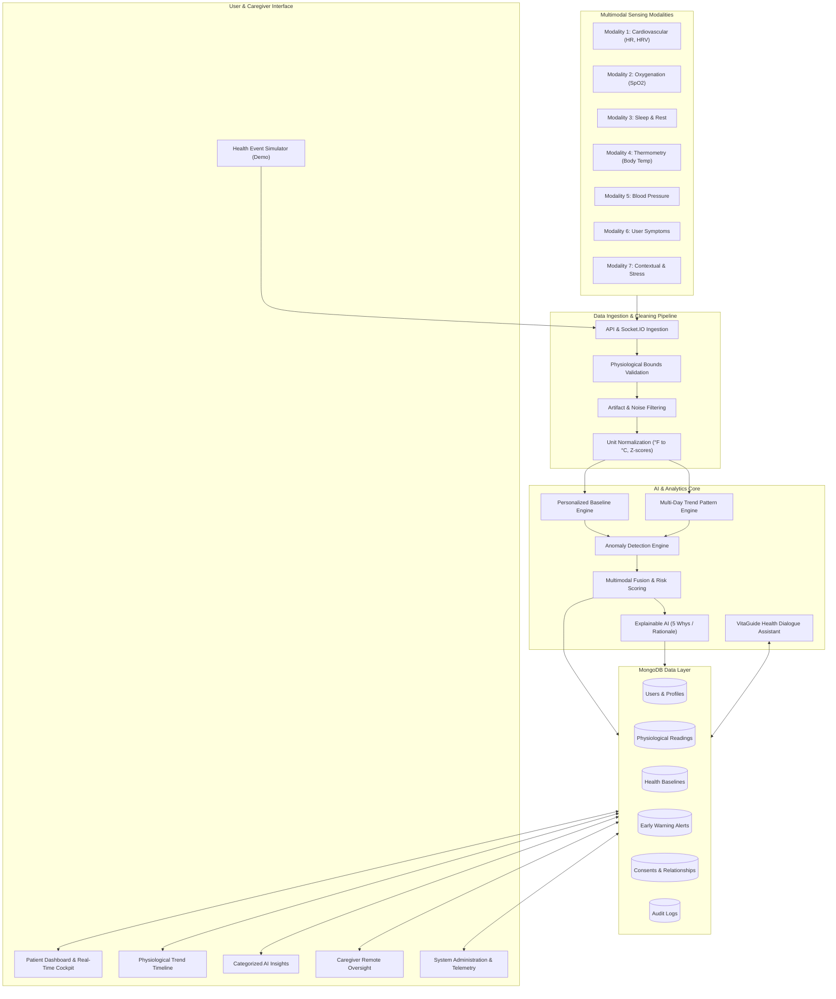

# VitaBridge AI - System Architecture

> **“Multimodal Human Sensing for Personalized Physiological Trend Monitoring and Early Warning”**

---

## 1. Overview & Non-Diagnostic Guarantee

VitaBridge AI is an intelligent health-monitoring and clinical decision-support platform. It continuously processes heterogeneous physiological and behavioral streams (Heart Rate, HRV, SpO2, Temperature, Blood Pressure, Sleep, Activity, Stress, and user-reported symptoms) to establish an individual health baseline, recognize physiological patterns, and generate early-warning alerts.

**Important Safety Principle**: VitaBridge AI is strictly a **decision-support and monitoring system**, NOT a diagnostic platform. It does not classify specific medical diseases, diagnose conditions, or prescribe medication dosages. All alerts are purely informational and instruct users to consult qualified healthcare providers when appropriate.

---

## 2. End-to-End System Architecture

---

## 3. Multimodal Sensing Modalities

VitaBridge ingests 7 distinct sensory modalities:

| Modality | Signals Measured | Unit | Sampling | Normal Baseline Range (Sarah) |
| :--- | :--- | :--- | :--- | :--- |
| **1. Cardiovascular** | Resting Heart Rate, HRV (RMSSD) | BPM, ms | Continuous / Minute | 68–74 BPM, 42–52 ms |
| **2. Oxygenation** | Peripheral Capillary Oxygen (SpO2) | % | Periodic / Sleep | 97–99% |
| **3. Sleep & Rest** | Duration, Sleep Stages, Sleep Quality | hours, 0-100 | Overnight | 7.0–8.0 hrs, 80-92 quality |
| **4. Thermometry** | Skin & Core Body Temperature | °C | Hourly / Sleep | 36.5–36.8 °C |
| **5. Blood Pressure** | Systolic / Diastolic Pressure | mmHg | Daily / Manual | 114–122 / 74–78 mmHg |
| **6. Symptoms** | User-Reported Symptom & Severity | Structured | As needed | None (Nominal) |
| **7. Context & Stress**| Steps, Caloric Burn, Acute Stress | Steps, score | Continuous | 7,500–9,500 steps, Low stress |

---

## 4. Personalized Baseline Engine

Instead of relying solely on broad population averages (e.g. standard 60-100 BPM), VitaBridge constructs an **individualized signature**:

- **Mean & Median**: Central tendency across 7, 30, and 90 days.
- **Rolling Standard Deviation ($\sigma$)**: Establishes user-specific normal variance boundaries.
- **Percentiles ($P_{10}, P_{25}, P_{75}, P_{90}$)**: Interquartile shaded corridors for charts.
- **Adaptive Exponential Moving Average (EMA)**:
  $$\mu_{t} = (1 - \alpha)\mu_{t-1} + \alpha x_t$$
  Where $\alpha = 0.03$ to allow gradual, natural adaptation to improved fitness or seasonal shifts without letting acute illnesses distort baseline signatures.

---

## 5. Multimodal Fusion & Risk Scoring

The fusion engine calculates two unified metrics on a 0–100 scale:

1. **Early Warning Score (EWS)**:
   $$EWS = \sum_{m \in \text{Modalities}} w_m \cdot S_m + \text{TrendAmplifier}$$
   - Cardiovascular: 25%
   - Oxygenation: 20%
   - Thermometry: 15%
   - Respiratory: 15%
   - Sleep & Rest: 10%
   - Symptoms: 10%
   - Activity: 5%

2. **Alert Levels**:
   - **GREEN (0–34)**: Stable equilibrium. Readings align with personal baseline.
   - **YELLOW (35–69)**: Mild deviation. Suggests restorative rest, hydration, and monitoring.
   - **RED (70–100)**: Strong or persistent multimodal divergence. Recommends contacting healthcare professionals if symptoms persist.

---

## 6. Explainable AI Architecture

Whenever an alert triggers, the Explainable AI engine generates plain-language explanations answering five questions:
1. **WHAT Happened**: Natural language summary of the detected deviation.
2. **WHY Was It Detected**: Multi-signal discordance and statistical deviation rationale.
3. **HOW Different From Baseline**: Exact numeric and percentage shifts from personal normal.
4. **WHICH Signals Contributed**: Modality contribution breakdown with exact weights.
5. **WHAT To Consider Doing**: Non-diagnostic, practical next steps (rest, re-check, contact doctor if severe).
